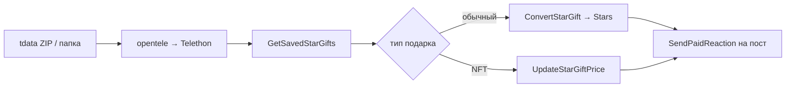

# tdataauto

Автоматизация для Telegram-аккаунта из **tdata** (Telegram Desktop):

1. **Продажа подарков за звёзды** — обычные подарки конвертируются в Stars (`convert`), NFT-подарки выставляются на маркетплейс (`resell`).
2. **Перевод звёзд в канал** — все доступные Stars отправляются **платной реакцией** на пост канала по ссылке (`https://t.me/.../123`).

> ⚠️ Работает только с **вашим** аккаунтом и tdata, к которым у вас есть доступ. Использование чужих сессий нарушает правила Telegram.

## Почему «бот не работает» — частые причины

| Симптом | Что проверить |
|--------|----------------|
| Не грузится tdata | Папка должна быть **из Telegram Desktop**, аккаунт уже залогинен; если стоит локальный пароль — `--passcode` |
| Звёзды не уходят в канал | На канале включены **платные реакции** (Настройки канала → Реакции → платные) |
| Баланс 0 после «продажи» | NFT выставлены на **перепродажу** — Stars придут только когда кто-то купит; мгновенно Stars даёт режим **convert** для обычных подарков |
| `CHANNEL_PRIVATE` | Аккаунт должен **быть подписан** на канал |
| `BALANCE_TOO_LOW` | Нечего отправлять или `KEEP_STARS` слишком большой |
| Ошибка `tgcrypto` при установке | Linux: `sudo apt install python3-dev gcc` и снова `pip install -r requirements.txt` |

## Установка

```bash
python3 -m venv .venv
source .venv/bin/activate
pip install -r requirements.txt
cp .env.example .env
# заполните BOT_TOKEN (для режима bot), CHANNEL_POST_URL и при желании API_ID/API_HASH
```

## CLI (одна папка tdata)

```bash
python -m tdataauto run --tdata /path/to/tdata --link "https://t.me/my_channel/42"
```

Переменные из `.env`: `SELL_MODE` (`convert` | `resell` | `both`), `RESELL_PRICE`, `KEEP_STARS`, `MAX_PAID_REACTION_BATCH`.

## Telegram-бот

```bash
python -m tdataauto bot
```

1. `/start`
2. Ссылка на пост канала
3. ZIP-архив с папкой `tdata`

## Как это устроено



## Приложение Star Flow

Тот же сценарий в окне Electron: обзор запусков, выбор `tdata`, продажа подарков и отправка звёзд на пост.

```bash
cd desktop
npm install
npm start
```

Окно повторяет тёмную панель: карточки метрик, тепловая карта запусков, график звёзд и таблица аккаунтов. Python-пакет `tdataauto` остаётся движком — приложение вызывает `python -m tdataauto run`.

Готовый Windows-файл собирается так:

```bash
cd desktop
npm install
npm run dist:win
```

На выходе `desktop/dist/StarFlow-0.1.0.exe`. Внутри уже есть Python, отдельно ставить его не нужно.

## Лицензия

MIT — см. [LICENSE](LICENSE).
